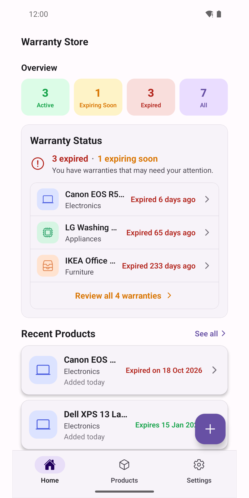
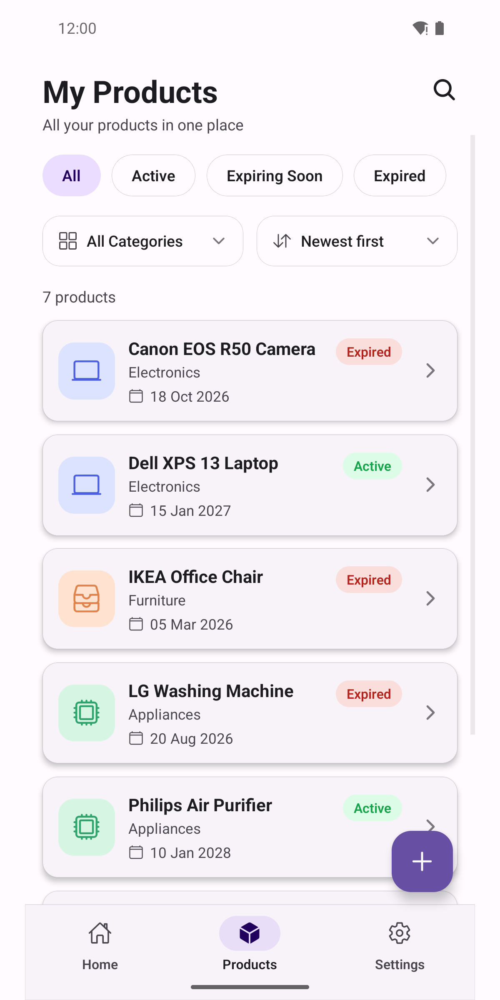
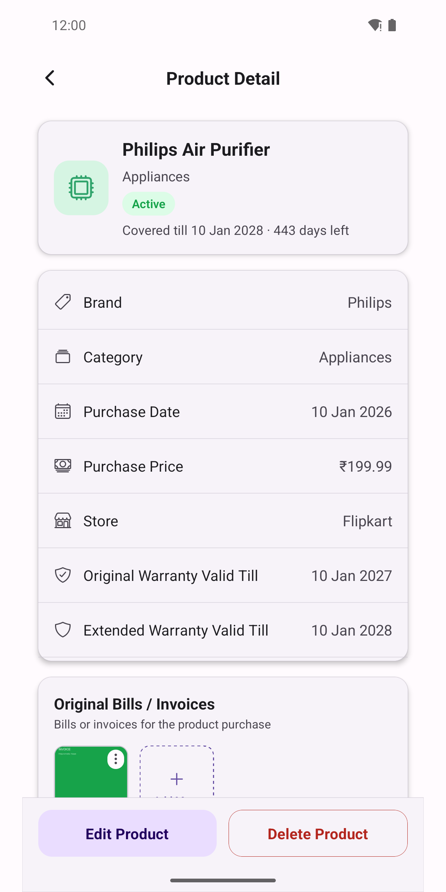
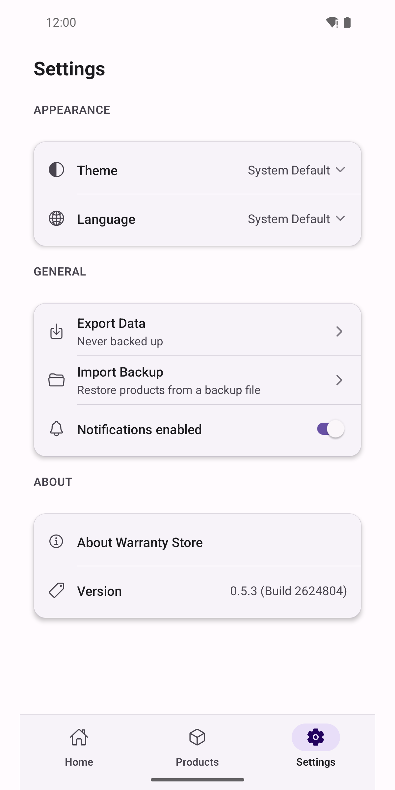
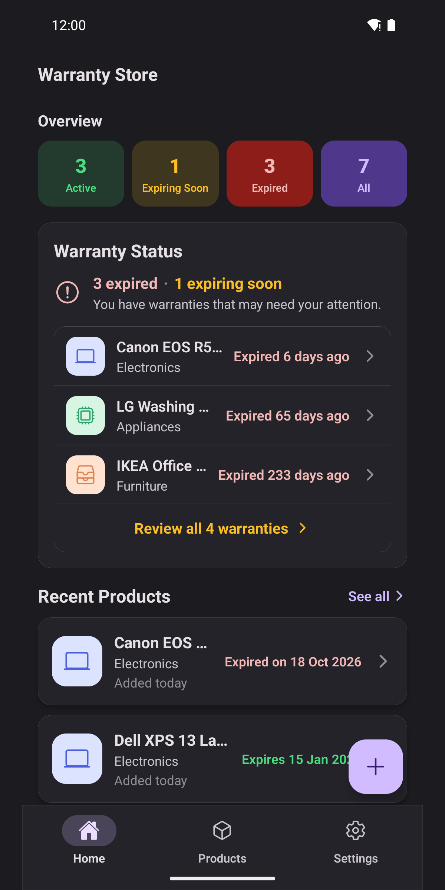

# Warranty Store

### Warranties and invoices, organized and offline.

## Overview

Warranty Store is a privacy-first Android app for tracking product warranties and invoice receipts. Add a purchased item once — its purchase date, warranty length, price, and store — and the app keeps track of when its cover expires, reminds you before it does, and keeps every invoice photo or PDF attached and easy to find. Everything lives on the device; nothing is uploaded anywhere.

## Key Features

- **Warranty tracking** — Record purchase date, warranty length, price, store, and notes for every item, with the warranty's valid-till date calculated automatically.
- **Extended warranty support** — Layer one or more extended warranty periods — provider, duration, and cost — on top of the original manufacturer cover, each tracked and reminded separately.
- **Invoice & document storage** — Attach invoice photos from the camera or gallery, or PDF documents, for both the original purchase and any extended warranty, and open them again anytime.
- **Expiry reminders** — Local notifications 30 days, 7 days, and on the day a warranty expires — no account or backend required.
- **Search & filter** — See items at a glance by status — active, expiring soon, or expired — right from the home screen.
- **Local backup & restore** — Export every item and its documents into a single zip file and restore it later; importing merges safely, so existing items are never overwritten.
- **Dark mode & multi-language** — Light, dark, or system theme, with English, Spanish, French, and German support.
- **Fully offline & private** — No account required, no data leaves the device, and no analytics.

## Problems It Solves

Warranty cards and receipts get lost in drawers, inboxes, and photo galleries, and warranty windows quietly close before anyone remembers to use them. Warranty Store keeps the proof of purchase and the coverage dates together in one place, and reminds you before it's too late to claim.

## Who It's For

Anyone who buys electronics, appliances, furniture, or other warrantied products and wants a simple, private way to remember what's covered, until when, and where the invoice is — without handing that data to a cloud account.

## Platforms & Availability

- Platform: Android
- Status: In development — coming soon to Google Play

## Screenshots

## Get Started

Warranty Store is launching soon on Google Play.
